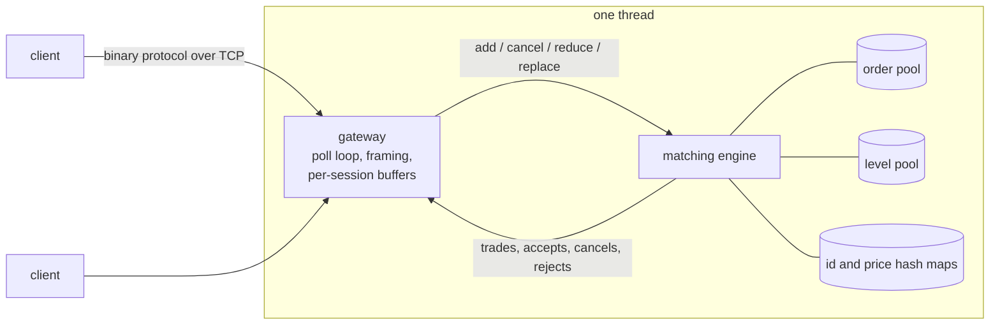

# Low-Latency Order Matching Engine

[](https://github.com/CharlieHubbard7/matching-engine/actions/workflows/ci.yml)

A price-time-priority limit order book and matching engine in C++20, served over a TCP gateway with a binary protocol and load-tested by replaying real Nasdaq order flow.

- **16 million messages per second** through the engine on a single thread, at a median of about 55 ns each, replaying 5 million Nasdaq messages against a book of 1.5 million resting orders.
- **Zero heap allocations** while matching. The benchmark counts every allocation in the process and fails if the count moves.
- **Checked against the exchange.** 94.9% of replayed executions fill the exact order Nasdaq reported filling.
- **About 1,900 lines**, no dependencies beyond the standard library and POSIX sockets.

## Results

Measured on an Apple M4 Pro (macOS, Apple clang 17, `-O3`), one thread for the engine.

| Test | Input | Result |
| --- | --- | --- |
| Engine, in process | Nasdaq ITCH, 5 M messages on a 1.5 M-order book | 16.5 M msgs/sec; 55 ns median, 220 ns p99 |
| Engine, in process | Synthetic, 5 M messages on a shallow book | 53 M msgs/sec; 18 ns median, 28 ns p99 |
| TCP gateway, 1,024 requests in flight | Nasdaq ITCH, same 5 M messages | 5.4–6.2 M msgs/sec |
| TCP gateway, one request at a time | Nasdaq ITCH, same 5 M messages | 49 µs median round trip, 66 µs p99 |

How to read these numbers:

- **The Nasdaq row is the realistic one.** It covers every symbol in the feed, with 1.5 million orders on 650,000 price levels, so nearly every message misses the CPU cache. The synthetic book holds a few thousand orders and fits in cache, which is why it runs three times faster.
- **Latencies are per message, averaged over 32-message batches.** The monotonic clock on Apple silicon ticks every 41 ns, which is too coarse to time one message. On a clock finer than 5 ns the benchmark times every message individually.
- **The round-trip figure is loopback TCP on macOS.** It is almost all kernel socket time; the engine accounts for well under 0.1 µs of it.

### The Nasdaq replay

The input is Nasdaq's public TotalView-ITCH 5.0 sample for 30 January 2019: the 1,513,287 orders resting at 09:35:00 are loaded as a starting book, then the next 5,000,000 order messages are replayed (2.26 M adds, 2.13 M cancels, 424 k replaces, 112 k executions, 72 k partial cancels).

ITCH publishes the result of matching, not the orders that caused it, so [`tools/itch_convert.cpp`](tools/itch_convert.cpp) reconstructs the flow. Adds, cancels and replaces map directly. Each execution becomes an immediate-or-cancel order on the opposite side at the resting order's price, tagged with the order the exchange filled so the replay can check its own answer:

- 94.9% of those fills hit the exact order Nasdaq filled.
- The other 5.1% hit an order at the same price that Nasdaq passed over. The public feed does not say why; a pure price-time book cannot reproduce those cases.
- As a knock-on effect, 853 of the 5 million messages (0.02%) are rejected because they refer to an order this engine had already filled.

## Design



- **Pools, not `new`.** Orders and price levels live in two arrays allocated at startup and are linked by 32-bit indices. Freed slots go on a LIFO free list, so recently used memory is reused first. An order is 32 bytes, two to a cache line.
- **Price level = FIFO.** Each level is an intrusive doubly linked list of orders, which gives time priority and O(1) cancel from the middle of the queue.
- **Book side = sorted list of levels.** The best price is the head, so matching never searches. A new level is placed by walking from the best price.
- **O(1) lookups.** Two fixed-capacity open-addressing hash maps (linear probing, backward-shift deletion, no tombstones) map order id to order and (symbol, side, price) to level.
- **Static dispatch.** The engine reports events through a template handler, so the gateway's serialiser and the benchmark's counters are inlined into the matching loop.
- **Lookahead prefetch.** When requests are queued in a receive buffer, the engine is told about the one 12 messages ahead and starts loading the hash-map slots it will need. On the Nasdaq replay this raised throughput from about 13 M to 16.5 M msgs/sec. Run the benchmark with `ME_NO_PREFETCH=1` to compare.
- **Gateway.** A single-threaded `poll()` loop over non-blocking sockets with `TCP_NODELAY`. Each connection has fixed receive and send buffers, and all responses to a batch of requests go out in one `send`. A fill is reported to both sides of the trade, and a session can only cancel or amend its own orders.

Supported operations: new order (resting or immediate-or-cancel), cancel, reduce in place (keeps queue position), and replace (new id, loses queue position).

## Wire protocol

Fixed-size little-endian messages, each starting with `{u16 length, u8 type, u8 reserved}`. Every request is answered by zero or more `Trade` messages followed by exactly one of `Accepted`, `Canceled` or `Rejected`. A client also receives a `Trade` whenever another client's order fills one of its own.

| Direction | Type | Fields after the header | Bytes |
| --- | --- | --- | --- |
| in | `N` new order | `u64 id, u32 price, u32 qty, u16 symbol, u8 side, u8 tif` | 24 |
| in | `C` cancel | `u64 id` | 12 |
| in | `M` reduce | `u64 id, u32 qty` | 16 |
| in | `R` replace | `u64 old_id, u64 new_id, u32 price, u32 qty` | 28 |
| out | `A` accepted | `u64 id, u32 leaves` | 16 |
| out | `T` trade | `u64 resting_id, u64 incoming_id, u32 price, u32 qty, u16 symbol, u16 reserved` | 32 |
| out | `X` canceled | `u64 id, u32 qty` | 16 |
| out | `J` rejected | `u64 id, u8 reason, 3 reserved` | 16 |

## Build and run

Requires CMake 3.20+ and a C++20 compiler (tested with Apple clang 17).

```sh
cmake -B build && cmake --build build
ctest --test-dir build

./build/bench                                          # synthetic flow, in process

scripts/fetch_itch.sh                                  # stream about 1 GB of Nasdaq's sample into data/
./build/bench data/itch.bin data/itch.seed.bin         # recorded flow, in process

./build/gateway 9000 &                                 # TCP gateway on 127.0.0.1:9000
./build/replay data/itch.bin --seed data/itch.seed.bin --window 1024   # throughput
```

For round-trip latency, restart the gateway and run the replay with `--window 1`. The gateway has to be restarted between replays because the recording reuses the same order ids.

## Testing

- **Unit tests** for priority, partial fills, cancel, reduce, replace, immediate-or-cancel and every reject reason.
- **Randomised cross-check.** 300,000 random operations run through both the engine and a simple `std::map` reference book; every event and the best bid and offer must match after each one.
- **End-to-end gateway test.** Starts the real binary and checks fills reaching both sessions, order ownership, a message split across TCP segments, and a malformed frame.
- **Sanitizers.** `cmake -B build-asan -DME_SANITIZE=ON` builds everything with AddressSanitizer and UndefinedBehaviorSanitizer; CI runs the tests that way on every push.

## Layout

```text
include/me/engine.hpp     order book and matching engine
include/me/flat_map.hpp   fixed-capacity hash map
include/me/protocol.hpp   wire messages, dispatch, lookahead prefetch
src/gateway.cpp           TCP server
src/replay.cpp            load-test client
bench/bench.cpp           in-process benchmark and allocation check
tools/itch_convert.cpp    Nasdaq ITCH 5.0 to wire messages
tests/                    engine and gateway tests
```

## Limitations and next steps

- **New price levels are the slow path.** Placing one walks the level list from the best price, about 10 steps on average in the Nasdaq replay, and that walk is most of the p99. A per-book index of occupied prices would remove it.
- **Single-threaded.** One core runs the sockets and every book. Sharding symbols across engine threads is the natural way to scale.
- **Orders outlive their connection.** There is no cancel-on-disconnect, and order ids share one namespace across sessions.
- **Fixed capacity.** When the order or level pool is full, new resting orders are rejected.
- **Not an exchange.** No persistence, market-data feed, auctions, or order types beyond limit orders.

## License

MIT. See [LICENSE](LICENSE). The Nasdaq sample data is downloaded by the script and is not part of this repository.
